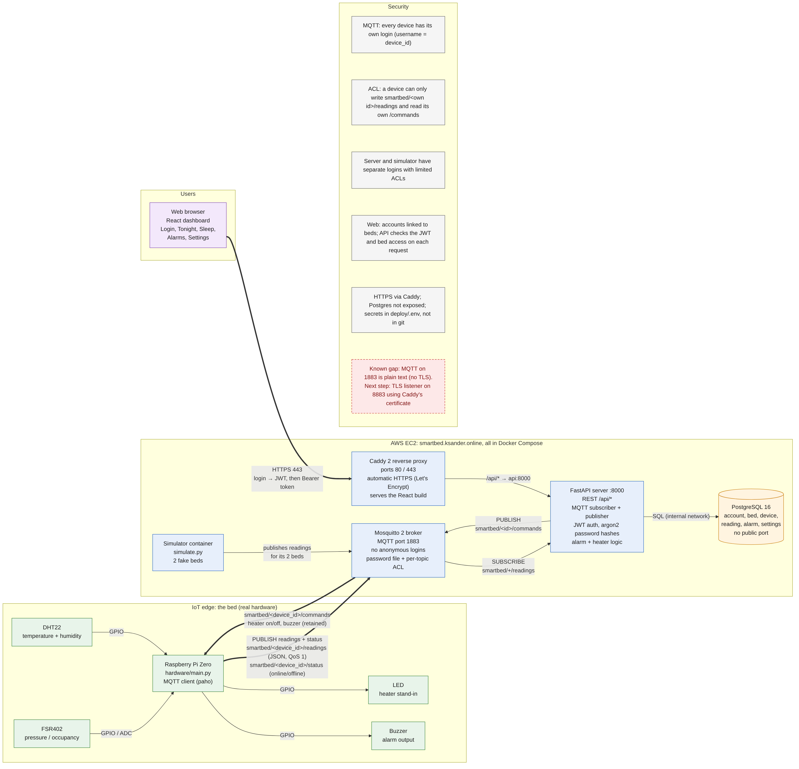

# SmartBed

**Repository:** https://github.com/ElColillas69/SmartBed
**Live system:** https://smartbed.ksander.online

SmartBed is an IoT system for monitoring a bed. It is for carers and relatives of someone
who needs looking after. A Raspberry Pi on the bed measures occupancy (FSR402 pressure
sensor) plus room temperature and humidity (DHT22). It sends the readings over MQTT to a
server on AWS, which stores them and shows them on a web dashboard. Users can see if the
person is in bed and how long they have been there, check room conditions and past nights,
and set alarms and a preferred temperature range. The server sends commands back to the Pi
(heater on/off, buzzer for alarms).

This was made for the G-CA2 IoT assignment.

## Architecture



The source of the diagram is [`docs/smartbed-architecture.mmd`](docs/smartbed-architecture.mmd) (Mermaid).

| Part | Where | What it does |
|------|-------|--------------|
| `hardware/` | Raspberry Pi Zero on the bed | Reads the FSR402 and DHT22, publishes readings over MQTT, carries out commands from the server (heater LED, buzzer) |
| Mosquitto 2 | AWS EC2, Docker | MQTT broker: publish/subscribe between the Pis and the server |
| `backend-fastapi/` | AWS EC2, Docker | FastAPI REST API and MQTT subscriber/publisher. Stores readings and handles alarm and heater logic |
| PostgreSQL 16 | AWS EC2, Docker | Accounts, beds, devices, readings, alarms, settings |
| Caddy 2 | AWS EC2, Docker | HTTPS reverse proxy (Let's Encrypt). Serves the React build and forwards `/api/*` to FastAPI |
| `frontend/` | Browser | React + Vite dashboard: Login, Tonight, Sleep, Alarms, Settings |
| Simulator | AWS EC2, Docker | `simulate.py` publishes like a real Pi would, for the two beds that have no hardware |

### Data flow

1. The Pi publishes a JSON reading to `smartbed/<device_id>/readings` every 30 seconds
   (QoS 1), plus `online`/`offline` to `smartbed/<device_id>/status`.
2. The FastAPI server subscribes to `smartbed/+/readings`, looks up which bed the device
   belongs to, and saves the reading in PostgreSQL.
3. The server works out the heater and alarm state, then publishes it as a retained message
   on `smartbed/<device_id>/commands`. The Pi reacts to that.
4. The browser logs in over HTTPS, gets a JWT, and calls `/api/beds/{bed_id}/...` for live
   readings, sleep history, alarms and settings.

## Security

- **All traffic over the internet is encrypted.**
  - The web app and API use HTTPS on 443. Caddy gets the certificate automatically.
  - The Pi connects to MQTT over TLS on **port 8883**, using the same Let's Encrypt
    certificate (`deploy/mosquitto/start.sh` copies it into Mosquitto).
  - Plain MQTT on 1883 is only used inside the private Docker network (by the API and the
    simulator). It is not published, and there is no inbound rule for it on AWS.
- **MQTT logins and per-device ACLs** (`deploy/mosquitto/aclfile`). Anonymous logins are
  off. Each Pi has its own login, and its username is its device id. A device may only
  publish to its own `/readings` and `/status` and read its own `/commands`, so a stolen
  Pi password can't write data onto another person's bed. The server and the simulator
  each have their own login, limited to the topics they need.
- **Web accounts.** Passwords are stored as Argon2 hashes (`pwdlib`). Logging in returns
  a JWT (HS256) that expires after 12 hours. Every bed endpoint checks that the user has
  been given access to that bed (`allowed_bed` in `backend-fastapi/app/auth.py`).
  You get access by claiming a bed with its pairing code.
- **Unknown devices are ignored.** A reading from a device id that is not registered to a
  bed is dropped.
- **Network exposure.** Only 22 (SSH, key only), 80, 443 and 8883 are open in the AWS
  security group. PostgreSQL and the API have no public port.
- **Secrets** (database password, JWT secret, MQTT passwords) live in `.env` files that
  are ignored by git. Only `.env.example` templates are committed.

## Running it locally

You need Python 3.10+ and Node 20+. An MQTT broker is optional for local use.

```bash
# Backend (SQLite by default)
cd backend-fastapi
python -m venv .venv
.venv\Scripts\activate          # Windows. On Linux/macOS: source .venv/bin/activate
pip install -r requirements.txt
cp .env.example .env            # set JWT_SECRET; leave MQTT_HOST empty to run without MQTT
python seed.py --demo-user      # demo beds + carer@example.com / password123
fastapi dev app/main.py         # http://127.0.0.1:8000/docs

# Tests
pytest

# Frontend (in a second terminal)
cd frontend
npm install
npm run dev                     # http://localhost:5173, proxies /api to port 8000
npm test
```

To test MQTT locally, run Mosquitto (for example `docker run -p 1883:1883 eclipse-mosquitto:2`
with a config that allows logins). Then set `MQTT_HOST=localhost` and run `python simulate.py`.

### Raspberry Pi

```bash
cd hardware
python -m venv .venv && source .venv/bin/activate
pip install -r requirements.txt
sudo pigpiod                    # the DHT22 driver uses pigpio
cp .env.example .env            # DEVICE_ID, MQTT login, MQTT_PORT=8883, MQTT_TLS=true
python main.py
```

## Deploying to AWS

Everything on the server runs in Docker Compose (`deploy/docker-compose.yml`).
Full steps are in [`deploy/README.md`](deploy/README.md). In short:

1. Start an Ubuntu EC2 instance with an Elastic IP. Open 22, 80, 443 and 8883 in the
   security group. Point the domain's A record at the instance (Cloudflare "DNS only").
2. Install Docker, clone this repository, then copy `deploy/.env.example` to
   `deploy/.env` and fill in every secret.
3. Create the Mosquitto password file with one login per account in `aclfile`.
4. Start everything and seed the beds:

```bash
cd deploy
docker compose up -d --build
docker compose exec api python seed.py --no-history
```

After a `git pull`, run `docker compose up -d --build` again. After Caddy renews the
certificate, run `docker compose restart mqtt`.

## Team

| Member | Role |
|--------|------|
| Aleksy | Frontend (React dashboard), FastAPI backend, MQTT integration, AWS deployment and security |
| Adrian | Hardware and testing: Raspberry Pi, DHT22 and FSR402 sensor code, Pi controller |
| Uche | Database and the first backend: SQL schema and queries, the original Flask API |

## Known issues

- The heater LED and the buzzer are not wired to the Pi yet. The server sends the
  commands, and `hardware/main.py` handles them, but nothing physical happens.
- Only Maureen's bed has a real Pi (`pi-maureen`). Patrick's and Siobhan's beds are
  simulated.
- Occupancy comes from one FSR402 with a fixed threshold (20 % by default), so a light
  person or an off-centre position can read as "out of bed". The light level is fixed at 0
  because there is no light sensor on the build.
- The seeded pairing codes are easy to guess. On a public server they should be replaced
  with random codes.
- Mosquitto has to be restarted by hand after Caddy renews the certificate (about every
  60 days).

## Use of AI

Parts of this project were written with help from Claude (Anthropic, 2026). Files that
contain generated code say so at the top. The full declaration is in `chat_use_log.md`.
