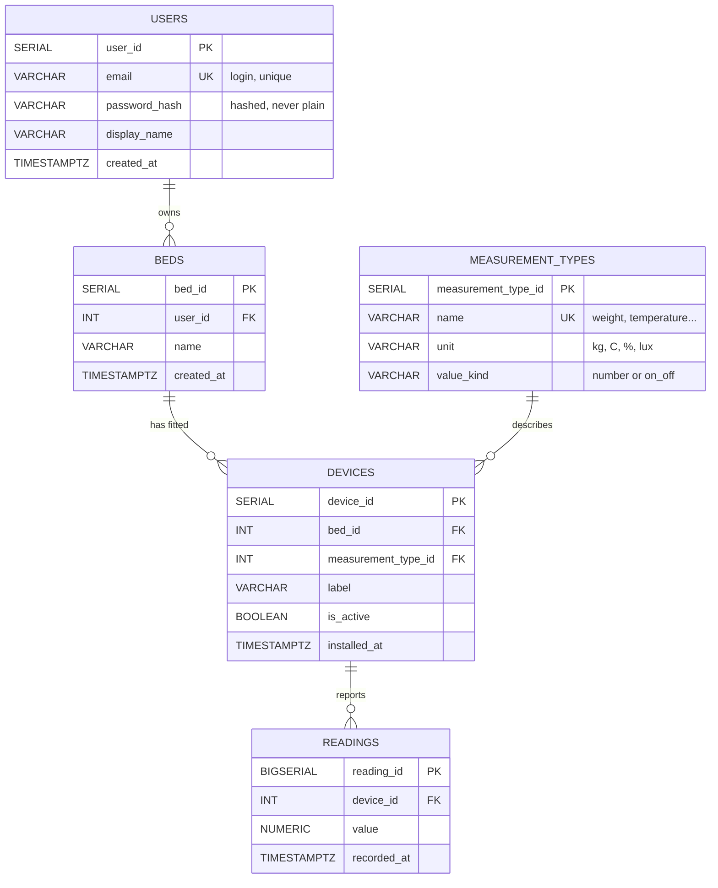

PostgreSQL

PK = primary key · FK = foreign key · UK = unique. Every relationship is one-to-many (one on the left, zero or more on the right).

## Relationships

- One **user** owns zero or more **beds**.
- One **bed** has zero or more **devices** fitted to it.
- One **measurement type** describes zero or more **devices** (e.g. every temperature sensor points to the "temperature" type).
- One **device** reports zero or more **readings** over time.
